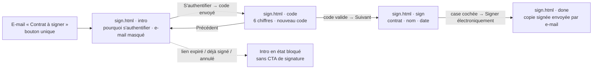

# Ndopify e-Signature — Journey Maps (Stage 1)

Sources: *Structure du Site Ndopify e-Signature*, *Ndopify — Pitch*, *Ndopify Vision + Mission*. Product context:
`CLAUDE.md` (contract domain) and the only contract template that exists today,
`ndopify-server/src/main/resources/mandate/contract/search.mjml` (*Mandat de recherche immobilière (location)*).

## What the site is

One page, `sign.html`, reached from the e-mail *Contrat à signer* (`ContractSignatureMailet`). Its single button opens
`sign.html?contract-id={contractId}&party-id={contractPartyId}`: the link names the contract and the person who must
sign it. The person isn't signed in anywhere: a Ndopify customer has no account, so the page authenticates them by a
one-time code sent to the e-mail address the contract has for them.

The doc defines four steps, numbered 1, 2, 3 and **5** (there is no step 4 in the source; the prototype shows them as
three steps plus a confirmation):

| # | Step (doc)        | Slide            | What happens                                                              | CTA                       |
|---|-------------------|------------------|---------------------------------------------------------------------------|---------------------------|
| 1 | Introduction      | `?step=intro`    | Why authenticate first; the code goes to the signer's e-mail              | **S'authentifier** (centered) |
| 2 | Authentification  | `?step=code`     | 6-digit code; request a new one                                           | Précédent / **Suivant**   |
| 3 | Signature         | `?step=sign`     | The contract (HTML, in a frame); name and date of signature; sign at the end | **Signer électroniquement** |
| 5 | Confirmation      | `?step=done`     | Signed; the signed copy is e-mailed automatically                         | —                         |

Doc rules applied throughout: slideshow with Précédent (left) / Suivant (right); Suivant enabled only once the
required fields are filled; the submit button only on the step before the confirmation, enabled only when the form is
valid; hints in an info panel (info icon, slightly smaller text) that stays visible once the form is valid; centered
CTAs; header = Ndopify logo image only (no menu: decision of 2026-10-18, overriding the doc's user menu); field and page names in English;
no remuneration or commission amounts or percentages; no section the doc doesn't define.

## Audiences and flows

Everyone who signs a Ndopify contract follows the same four steps. What differs is *what* they sign, and so what they
worry about. The three audiences are the three kinds of signer the platform has or plans:

| # | Audience                         | Contract                                                 | Exists today?                       | Main worry                                                     |
|---|----------------------------------|----------------------------------------------------------|-------------------------------------|----------------------------------------------------------------|
| A | **Locataire / chercheur** (mandant) | *Mandat de recherche immobilière (location)*: the customer's mandate to the agent | **Yes**: the only template (`MANDATOR`, signs; the agent is a party that doesn't sign) | "Is this real? Am I committing to pay something before I've found a home?" |
| B | **Bailleur** (mandant)           | *Mandat de mise en location* (LANDLORD mandate)          | No template yet                     | "Do I keep control of my property and of the rent?"           |
| C | **Parties au bail** (locataire + bailleur) | *Contrat de bail* (`LEASE_AGREEMENT`, number `BAIL-…`) | No template yet                     | "Is this the lease we agreed on, and does the other side sign the same text?" |

**Flow A drives the prototype**: its sample contract is the real template's wording. B and C reuse the page
unchanged. Only the contract in the frame and the intro's contract label differ, and both come from the server. The
page's own copy is written so it reads true for all three. The prototype can show the blocked states with
`?state=signed|expired|cancelled` (prototype only).

**"The three wizard pages" (Stage 3)** = the three slides before the confirmation: `intro`, `code`, `sign`. They are
the only form in the doc. The confirmation is the terminal state, not a step.

## Journey map — A. Locataire signing a *mandat de recherche*

Emotion scale −3 … +3. The customer left their details on *Trouver un bien* a few days ago; an agent accepted the
mandate and sent it for approval. They get the e-mail on their phone, often on WhatsApp's in-app browser or between
two things.

| Step | Action | Touchpoint | Emotion | Pain points / risks | Opportunity / design response |
|------|--------|------------|---------|---------------------|-------------------------------|
| 0 | Opens the e-mail *Contrat à signer*, taps the single button | Mail app → mobile browser | 0 (wary) | Phishing fear: Cameroon's rental market is full of scams (pitch: *arnaques à l'avance*) | The page has to look like the e-mail it came from: same logo and colours, and its first words name the contract they're expecting |
| 1 | Reads why they must authenticate | `intro` | −1 → +1 | "Why a code? Is someone trying to get into my account?" Not knowing which address the code goes to | Short reason first ("pour votre sécurité, seule la personne désignée peut signer"); show the **masked** address (`r•••@gmail.com`), never the full one. Name the contract type and number, so they know what they'll sign. Say up front that there is nothing to pay at this step |
| 1→2 | Taps **S'authentifier** | — | 0 | Waiting for the e-mail; might switch apps and lose the page | The button shows it's sending, then the slide changes; the step stays in the URL (`?step=code`), so coming back to the tab keeps it |
| 2 | Switches to the mail app, copies the code, comes back | `code` | −1 | Typing on a phone keyboard; code in spam; code expired (5 min) | One `inputmode="numeric"` field with `autocomplete="one-time-code"` (iOS/Android offer the code); Suivant enables at 6 digits; "Recevoir un nouveau code" always visible (no timer); the hint says where to look (spam, *Promotions*) and how long it lasts |
| 2 | Wrong or expired code | `code` | −2 | Dead end | The error names the cause and the fix: "Ce code a expiré. Demandez-en un nouveau ci-dessous." / "Code incorrect. Vérifiez les 6 chiffres reçus par e-mail." The typed code stays in the field |
| 3 | Reads the contract | `sign` (frame) | 0 → +1 | Long legal text on a small screen; fear of hidden fees (*Honoraires et frais*) | The contract in a bordered frame, at reading size, scrolling with the page (no nested scrollbar on mobile); the signature block sits **after** the contract, as the doc asks, so scrolling to it means passing the whole text |
| 3 | Sees their name and today's date, ticks the consent box, taps **Signer électroniquement** | `sign` | +1 | "What exactly am I agreeing to? Can I change my mind?" Tapping by mistake | Name and date shown as on paper ("Signé par … le …"); one required box, "J'ai lu le contrat et j'accepte de le signer électroniquement"; the button is disabled until it's ticked; the hint explains that the signature records the date, the time and the device |
| 5 | Sees the confirmation | `done` | +2 | "Where's my copy?" | Says it plainly: the signed contract is sent to their e-mail address, automatically. Nothing else to do. No upsell, no extra section |

### B. Bailleur (variant)

Same steps. Differences: the intro names a *Mandat de mise en location*; landlords are older on average and more
often on a shared or family phone. The masked address and the "who must sign" line matter more here, since someone
else may be holding the phone. Their main worry (control of the property and of the rent, per the pitch: *le bailleur
conserve 100 % du contrôle direct sur l'encaissement de ses fonds*) belongs in the contract's own text, not in
new page sections.

### C. Parties au bail (variant)

Two signers, each with their own link and code. Each must know that the other signs the **same** text, and that the
lease only takes effect once both have signed (`SIGNED` after the last required signature). The confirmation's
wording therefore can't say "the contract is in force" for a multi-party contract. It says "your signature is
recorded", and the signed copy follows by e-mail. The prototype uses that neutral wording for all three.

### Blocked states (all audiences)

The link can be stale: contract `EXPIRED` (past its 7-day `signatureDeadline`), `CANCELLED`, already signed by this
party, or a party whose signature isn't required. These are not new sections. They're the intro slide with a
different message and no S'authentifier button, so a stale link never asks for a code. Example messages:

- Déjà signé: « Vous avez déjà signé ce contrat. Une copie signée vous a été envoyée par e-mail. »
- Expiré: « Le délai de signature de ce contrat est dépassé. Contactez votre agent pour en recevoir un nouveau. »
- Annulé: « Ce contrat a été annulé. Il n'y a plus rien à signer. »

## Header

The Ndopify logo image only. The doc also asks for a user menu (initials → Profil, Déconnexion); it was **removed
on 2026-10-18 by decision of the product owner**: a signer has no account, and the page is a single task.
## Decisions taken where the doc is silent or ambiguous

1. **Where "redemander un nouveau code" lives.** The doc puts it on step 1. In one slideshow page, the natural place
   is the code slide, where the code is missing. Step 1's S'authentifier also sends a new code if pressed again
   (after Précédent).
2. **Consent checkbox on `sign`.** The doc only says "submit active once every field is valid". Without a field, the
   rule is empty, and an e-signature needs explicit consent. A single required checkbox (`name="consent"`) is the
   minimum. It's a field of the step, not a new section.
3. **No Précédent on `intro`**: it's the first step (Partner Central convention). **No Précédent on `sign`**: going
   back to a used code makes no sense. There is no way back once signing has started, other than closing the page.
4. **No commission amounts in the samples.** The real template says *Commission de succès : 1 mois de loyer*. The doc
   forbids showing commission amounts or percentages, so the prototype's sample says *selon le barème en vigueur*.
   **This is a conflict between the source doc and the real contract template**: the served page will show whatever
   the server generated. Someone has to decide whether the contract may state the commission. The prototype can't.
5. **No marketing page.** The command asks for "the content of the marketing page tailored to the audience", but the
   e-signature doc defines only the signing page and forbids undefined sections. The audience-tailored content lives
   in the intro's wording and in the hints, not in a separate page.
6. **Page and parameters in English** (`sign.html`, `step`, `contract-id`, `party-id`, `code`, `consent`), content in
   French.

## Synthetic persona tests (wizard: Jordan, Sam, Casey)

Run on the design above, before any HTML. These are the personas Stage 3's impeccable critique will reuse.

### Jordan — Confused First-Timer (a customer who has never signed anything online)

**Task:** sign the *mandat de recherche* from the e-mail. **Result:** completes, if the intro answers "why a code".

| Step | Action | Emotion | Notes |
|------|--------|---------|-------|
| intro | Reads every line | −1 | Needs to know it's the contract they expect, that nothing is paid now, and where the code goes |
| intro | Taps S'authentifier | 0 | Clear single action |
| code | Looks for the code | −2 | Doesn't know to look in spam; the hint must say so |
| code | Types it | +1 | Suivant enabling at 6 digits confirms they did it right |
| sign | Reads the contract | −1 | Worried by *Honoraires et frais*; needs plain hint text: "rien n'est payé en signant" |
| sign | Ticks, signs | +1 | Name and date shown as on paper are reassuring |
| done | Reads the confirmation | +2 | Wants to know where the copy is. Answered |

**Issues:** [3] "Why a code" must come first in the intro; [2] the spam hint; [2] no-payment-on-signing reassurance on `sign`.

### Sam — Accessibility-dependent (screen reader, keyboard only)

**Task:** same. **Result:** completes if focus and announcements are handled.

| Step | Action | Emotion | Notes |
|------|--------|---------|-------|
| intro | Tabs to the button | 0 | Needs an `h1` per slide, and the step ("Étape 1 sur 3") announced |
| code | Slide changes | −2 | Focus must move to the new slide's heading, or nothing is announced |
| code | Types the code | 0 | The field needs a visible `label`, the hint tied by `aria-describedby`, errors via `aria-live` |
| sign | Reads the contract | −1 | The frame must not trap focus. Content inline with headings (`h2`), not an `<iframe>` without a title |
| sign | Checks the box, signs | +1 | Disabled button: say why (the hint names the box) |
| done | Confirmation | +1 | Focus on the confirmation heading |

**Issues:** [3] focus management on slide change; [3] contract headings readable; [2] `aria-live` errors.

### Casey — Distracted Mobile User (one hand, interrupted, weak 3G)

**Task:** same, in the middle of a commute. **Result:** completes if state survives app switching.

| Step | Action | Emotion | Notes |
|------|--------|---------|-------|
| intro | Taps S'authentifier | 0 | Button must be big and reachable (≥ 44 px) |
| code | Leaves for the mail app, returns | −2 | The step must be in the URL; the code field must still be there |
| code | Pastes the code | +1 | `autocomplete="one-time-code"` and paste support |
| sign | Scrolls a long contract | −1 | No nested scroll; the sign block reachable at the bottom, within thumb reach |
| sign | Signs | +1 | Busy state on the button over a slow network, no double submit |
| done | Confirmation | +2 | Short |

**Issues:** [3] state in the URL; [2] no nested scroll; [2] busy state / no double submit.

## Hand-off to Stage 2

- Pages: `sign.html` only (+ `assets/css/`, `assets/js/`, `assets/images/` copied from Partner Central's logo set).
- Tokens: `DESIGN.md` (same brand as Partner Central and the website).
- Every persona issue above is a requirement for the page, and gets checked again in Stage 3.

## Stage 3 — impeccable critique vs. these persona tests

impeccable's design review used the same wizard personas (Jordan, Sam, Casey) on the built page (score before fixes:
26/40). It **disagreed** with the Stage 1 predictions above in the following places. They are listed here, not
resolved:

| Persona | Stage 1 said | Stage 3 found | Status after fixes |
|---|---|---|---|
| Jordan | Suivant enabling at 6 digits confirms the code (+1) | Enabling had no visible effect: the disabled style was missing | Fixed: gray `button-disabled` until valid |
| Jordan | "Rien n'est payé en signant" settles the fees worry (−1) | Deeper valley: "frais de visite payables avant chaque visite" plus a commission with no amount, and no sender named, reads like the advance-fee scams the pitch warns about | Partly fixed: "Envoyé par" on the intro, a separate no-payment notice after the contract, the agent's contact in blocked states. **Open:** the server template's fee wording, and the doc's no-amount rule versus a contract that states the commission |
| Sam | An `h1` per slide; contract headings in `h2` | Not needed: one `h1` → `h2` → `h3`/`h4` is a valid outline (implemented that way) | No change |
| Sam | `aria-live` errors everywhere | Missing on the code error, which matters most there (focus is already in the field on Enter) | Fixed: `role="alert"` |
| Casey | Paste support (+1) | `maxlength="6"` cut " 123 456" to 12345 before the digits were cleaned up | Fixed: no `maxlength`, the script keeps 6 digits |
| Casey | State survives app switching | Only within the same tab: the e-mail's link reopened in a new tab started over (sessionStorage) | Fixed in the prototype (localStorage per contract + signer); the served page keeps it on the server |
| — | (not foreseen) | CTA below the fold on phones; code field not focused; Back on `sign` changed the URL but not the slide | Field focused, Back fixed; the CTA is still about 240 px below the fold at 390×844 (the doc's explanation comes before it) |
